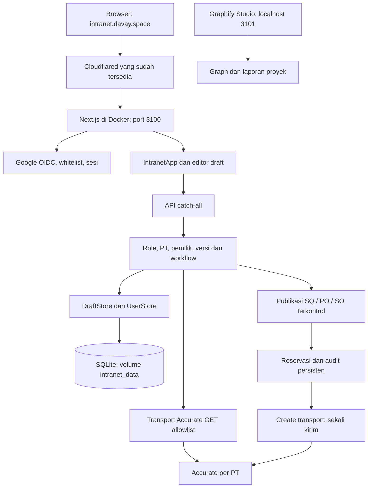

# Peta proyek dan deployment Docker lokal

Dipetakan dari `ko-indra/gastro-intranet`, branch `main`, commit `b6b29ee` (`Publish quotations to Accurate before selecting sales orders`), kemudian diperbarui untuk revisi UI pada 19 Oktober 2026. Repository tujuan: https://github.com/piemoul/gastro-intranet-promax. Lihat [pemeriksaan UX](ui-responsive-review.md) dan [environment deployment](environment.md).

## Akses dan runtime

| Tujuan | Alamat / konfigurasi |
| --- | --- |
| Aplikasi publik melalui Cloudflare | https://intranet.davay.space |
| Aplikasi pada mesin ini | http://localhost:3100 |
| Peta Graphify interaktif, hanya lokal | http://localhost:3101 |
| Container aplikasi | `gastro-intranet`, image `gastro-intranet:local` |
| Container peta | `gastro-intranet-graph`, image `nginx:alpine` |
| Database lokal persisten | Volume Docker `gastro-intranet_intranet_data`, dipasang pada `/app/.data` |
| Konfigurasi privat | `.env.local`, dikecualikan dari Git dan image Docker |
| Origin aplikasi | `APP_URL=https://intranet.davay.space` |
| Callback Google yang perlu didaftarkan | `https://intranet.davay.space/api/auth/google/callback` |

OAuth Google sudah aktif memakai OAuth client **Gastro Intranet** pada project `gastro-intranet-2026`. Callback domain Cloudflare telah ditambahkan; secret tambahan dibuat dengan persetujuan pengguna dan disimpan hanya pada `.env.local` untuk environment container. Secret deployment lama tetap aktif. Login end-to-end memakai `malesmikirbos@gmail.com` berhasil membuka Dashboard sebagai master admin. Gunakan domain publik untuk alur login serta operasi aplikasi karena pemeriksaan Origin mengikuti `APP_URL`.

Cloudflared yang sudah ada di Docker Desktop menggunakan origin `http://host.docker.internal:3100`. Setelah container aplikasi hidup, domain publik membalas HTTP 200. Konfigurasi tunnel tidak diubah.

Image menjalankan Next.js standalone dengan user non-root, Node.js 24, healthcheck `/login`, serta restart policy `unless-stopped`. Lima variabel integrasi Accurate tersedia langsung dalam `.env.local` Intranet dan diteruskan ke environment container. Mount file WMS telah dilepas dan `INTRANET_WMS_ENV_FILE` dikosongkan; runtime tidak bergantung pada file WMS. Database maupun autentikasi WMS tidak digunakan. Compose secara eksplisit memilih SQLite lokal.

## Arsitektur

Stack utama: Next.js 16.3.6 App Router, React 19.2.4, TypeScript, Zod, JOSE, SQLite bawaan Node.js, serta driver PostgreSQL `postgres` untuk deployment yang memakai Neon.



## Modul dan titik masuk

| Area | File utama | Peran |
| --- | --- | --- |
| Gerbang aplikasi | `src/app/page.tsx` | Memeriksa sesi, mengalihkan pengguna tanpa login ke `/login`. |
| Antarmuka utama | `src/components/intranet-app.tsx` | Dashboard, SQ, SO, PO, persetujuan, master, audit, pengguna, dan pilihan PT. |
| Editor dan detail | `src/components/draft-editor.tsx`, `record-views.tsx`, `publication-panel.tsx` | Formulir draft, tampilan data dan penerbitan eksplisit. |
| API bisnis | `src/app/api/[...path]/route.ts` | Endpoint sesi, pengguna, draft, transisi, audit, lookup Accurate, publikasi dan rekonsiliasi. |
| Google OAuth | `src/server/auth/google.ts`, `src/app/api/auth/google/` | OIDC, signature/claims, PKCE, nonce dan callback. |
| Akun dan sesi | `src/server/auth/users.ts`, `pg-users.ts`, `session.ts` | Whitelist, binding Google sub, peran, PT dan pencabutan sesi. |
| Domain dan validasi | `src/lib/domain.ts`, `validation.ts`, `calculations.ts` | Jenis dokumen, peran, status, payload dan estimasi nilai. |
| Aturan workflow | `src/server/workflow.ts` | Pemeriksaan peran, pemilik, tim, PT dan transisi dokumen. |
| Penyimpanan | `src/server/store.ts`, `pg-store.ts`, `postgres.ts` | SQLite / PostgreSQL, transaksi, versi, idempotensi dan audit. |
| Sumber dan SQ | `src/server/draft-sources.ts`, `quotation.ts` | Identitas sumber Accurate, kesesuaian referensi, pemilihan SQ dan turunan SO. |
| Pembacaan Accurate | `src/server/accurate/service.ts`, `transport.ts`, `normalize.ts` | Pencarian, list/detail GET allowlist, normalisasi dan isolasi kredensial per PT. |
| Penerbitan Accurate | `src/server/publish-order.ts`, `publication-state.ts`, `accurate/order-payload.ts`, `create-transport.ts` | Reservasi, payload terbatas, pengiriman tunggal dan verifikasi hasil. |
| CI / produksi Vercel | `.github/workflows/ci.yml`, `scripts/deploy-verified.mjs` | Pemeriksaan sebelum rilis commit terverifikasi; terpisah dari Docker lokal. |

## Domain bisnis

Tiga PT: Gastro Gizi Sarana (GGS), Resto Sarana Prima (RSP), dan Sarana Refrigeratama (SRI). Peran aplikasi: sales, kepala sales, importer, kepala importer, dan master admin. Semua endpoint data menerapkan autentikasi serta pembatasan PT/peran/pemilik di server.

- **SQ → SO:** sales menerbitkan SQ lengkap miliknya; kepala sales/admin memilih SQ Accurate; SO lokal disiapkan, disetujui, lalu diterbitkan melalui konfirmasi eksplisit.
- **PO:** importer menyiapkan draft, kepala importer menyetujui dan menerbitkan PO melalui konfirmasi eksplisit.
- **Master barang/klien dan edit dokumen Accurate:** perubahan berupa usulan lokal; dokumen/master Accurate yang sudah ada tidak dimutasi.
- **Keandalan:** versi optimistis, request idempotensi, audit transaksional, satu turunan SO aktif per SQ, serta reservasi sebelum mengirim ke Accurate. `PUBLISHING`, `UNCERTAIN`, dan `PUBLISHED` mengunci perubahan/pengiriman ulang; hasil tidak pasti memerlukan rekonsiliasi baca-saja.
- **Penyimpanan alternatif:** bila Neon diaktifkan pada deployment lain, objek aplikasi dibatasi awalan `intranet_`; tabel WMS tidak diubah.

Dokumen lama `docs/deployment.md` dan sebagian `docs/accurate-field-matrix.md` masih menyebut semua operasi Accurate GET-only / SQ belum diterbitkan. Kebijakan terkini mengikuti `AGENTS.md`, README, `docs/accurate-publication.md`, dan implementasi yang sudah mendukung create SQ/PO/SO terkontrol. Konflik dokumentasi ini ditandai dalam graph.

## Graphify

Graphify 0.17.1 dipakai dengan runtime TypeScript. Peta mencakup simbol kode, dokumentasi, logo, konteks histori Git, deployment Docker, pemeriksaan Accurate, serta revisi login dan shell responsif. Jumlah node/relasi/komunitas terkini tersedia pada `GRAPH_REPORT.md` dan perintah `graphify summary`; statistik tidak disalin di sini agar dokumen tidak tertinggal setiap pembaruan graph. Node dokumentasi memiliki provenance. Deskripsi naratif penuh untuk setiap simbol belum dibuat.

Artefak utama:

- `.graphify/GRAPH_REPORT.md`: laporan komunitas, hub, hubungan dan pertanyaan penelusuran.
- `.graphify/graph.json`: graph yang dapat ditelusuri mesin.
- `.graphify/studio/`: visualisasi interaktif yang dihasilkan lokal dan disajikan container pada port 3101; tidak di-commit.
- `.graphify/.graphify_runtime.json`: bukti runtime lokal dengan `runtime: typescript`; tidak di-commit.

Graph yang dipublikasikan memakai path sumber relatif repository. Manifest/cache mesin dan sidecar kutipan penuh tetap lokal. Ekspor Graphify 0.17.1 dapat salah menandai kutipan source seperti path import relatif atau endpoint URL sebagai path filesystem; audit publikasi memisahkan artefak yang di-commit dari state lokal tersebut.

Hub utama: `DraftStore`, `PgDraftStore`, `Actor`, `PgUserStore`, dan `UserStore`. Hub ini menghubungkan aturan workflow, akses pengguna dan persistensi. Penelusuran lanjutan yang berguna: bagaimana Actor membatasi PT/pemilik; bagaimana reservasi mencegah penerbitan ganda; bagaimana SQLite dan PostgreSQL mempertahankan aturan audit/versi yang sama.

```powershell
graphify summary --graph .graphify/graph.json
graphify query "publication reservation" --graph .graphify/graph.json --budget 1500
graphify explain DraftStore --graph .graphify/graph.json
```

## Mengoperasikan Docker

Jalankan dari folder repo ini:

```powershell
# Menyalakan / membangun ulang. Build juga menjalankan lint, typecheck dan tes.
docker compose --env-file .env.local up -d --build

# Status dan log aplikasi.
docker compose --env-file .env.local ps
docker compose --env-file .env.local logs --tail 100 app

# Setelah mengisi GOOGLE_CLIENT_ID dan GOOGLE_CLIENT_SECRET di .env.local.
docker compose --env-file .env.local up -d --force-recreate app

# Menghentikan layanan; volume data tetap tersedia.
docker compose --env-file .env.local stop
```

## Verifikasi

Build Linux Docker berhasil menjalankan lint, typecheck, **80 tes lulus, 0 gagal, 2 dilewati**, dan build produksi. Dua tes yang dilewati memerlukan database PostgreSQL pengujian eksplisit. Tes symlink yang sebelumnya ditolak Windows berhasil pada Linux container.

HTTP lokal dan publik: `/login` 200, `/privacy` 200, serta `/api/session` dan `/api/drafts` tanpa autentikasi 401. Graphify Studio lokal membalas 200. Pemeriksaan browser tidak menemukan error JavaScript. Google OAuth end-to-end telah berhasil: tombol login → Google account chooser → akun developer yang diminta → Dashboard Intranet dengan tiga pilihan PT dan draft lokal kosong. Pengujian tidak membuat dokumen komersial.

Pembacaan live Accurate untuk ketiga PT juga telah diverifikasi setelah login: 15 daftar, 14 sampel detail, serta 15 tampilan antarmuka berhasil. Rincian dan total data ada di [laporan pemeriksaan Accurate](accurate-connection-check.md). SQ RSP kosong secara normal; tidak ada transaksi percobaan yang dibuat.

Audit dependency dari lockfile upstream mencatat 8 temuan high; detail tersimpan lokal pada `.logs/npm-audit.json`. Versi dependency upstream belum diubah dalam pekerjaan clone/pemetaan/containerisasi ini. Tidak ada transaksi percobaan yang dikirim ke Accurate.
